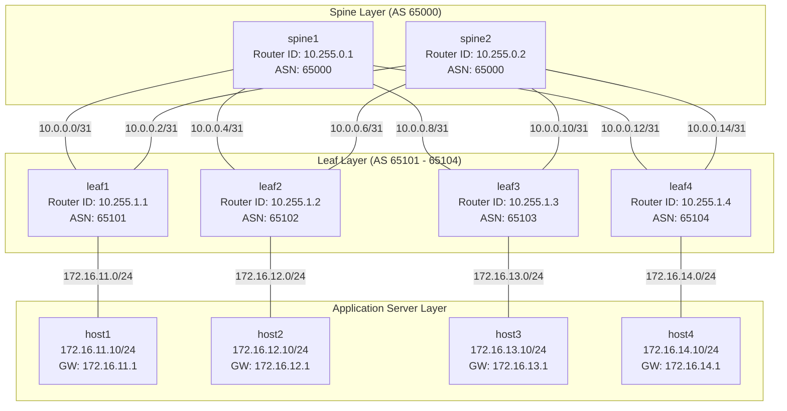

# Data Center Fabric Architecture

## 1. Overview

This project implements an automated, production-grade 2-tier Spine-Leaf (Clos) Data Center fabric simulated using [Containerlab](https://containerlab.dev/) and [FRRouting (FRR)](https://frrouting.org/).

The architecture connects 2 Spine switches, 4 Leaf switches, and 4 Linux application server containers into a non-blocking, multi-path forwarding fabric.

---

## 2. Architectural Principles

### 2.1 Why Clos / Spine-Leaf?
Traditional three-tier data center architectures (Core-Aggregation-Access) relied heavily on Spanning Tree Protocol (STP) to eliminate switching loops. STP prevents loops by blocking redundant links, effectively wasting 50% or more of available bisectional bandwidth.

In contrast, a 2-Tier Spine-Leaf Clos architecture:
1. **Eliminates STP**: Every link is an active Layer 3 routed interface.
2. **Deterministic Latency**: Exactly 2 hops between any pair of servers connected to different Leafs (`Host -> Leaf -> Spine -> Leaf -> Host`).
3. **Equal-Cost Multi-Pathing (ECMP)**: Traffic across multiple Spine switches is load-balanced based on L3/L4 packet hashing.
4. **Horizontal Scalability (Scale-Out)**: Throughput can be scaled out by adding more Spine switches; capacity can be scaled out by adding more Leaf switches.

### 2.2 Clos Rules
1. **No Spine-to-Spine Links**: Spines do not connect directly to one another. Traffic between Spines is never routed east-west.
2. **No Leaf-to-Leaf Links**: Leafs do not peer directly with each other in this tier. All inter-leaf traffic traverses the Spine tier.
3. **Every Leaf Connects to Every Spine**: Guarantees maximum path redundancy and fault isolation. If any single Spine fails, bandwidth drops by 50%, but zero destination subnets lose connectivity.

---

## 3. Node Inventory

| Node Name | Node Role | Base Image | Purpose |
|---|---|---|---|
| `spine1` | Spine Switch | `quay.io/frrouting/frr:10.2.1` | Core transit router for spine-leaf fabric |
| `spine2` | Spine Switch | `quay.io/frrouting/frr:10.2.1` | Core transit router for redundant pathing |
| `leaf1` | Leaf Switch | `quay.io/frrouting/frr:10.2.1` | Top-of-Rack (ToR) switch for Host 1 subnet |
| `leaf2` | Leaf Switch | `quay.io/frrouting/frr:10.2.1` | Top-of-Rack (ToR) switch for Host 2 subnet |
| `leaf3` | Leaf Switch | `quay.io/frrouting/frr:10.2.1` | Top-of-Rack (ToR) switch for Host 3 subnet |
| `leaf4` | Leaf Switch | `quay.io/frrouting/frr:10.2.1` | Top-of-Rack (ToR) switch for Host 4 subnet |
| `host1` | Server Node | `alpine:3.20` | Workload container in 172.16.11.0/24 |
| `host2` | Server Node | `alpine:3.20` | Workload container in 172.16.12.0/24 |
| `host3` | Server Node | `alpine:3.20` | Workload container in 172.16.13.0/24 |
| `host4` | Server Node | `alpine:3.20` | Workload container in 172.16.14.0/24 |

---

## 4. Fabric Links Summary

- **8 Router-to-Router Point-to-Point Links**:
  - `/31` subnets per RFC 3021.
  - Configured with `ip ospf network point-to-point`.
  - Directly establish single-hop eBGP neighbor relationships.
- **4 Server-to-Leaf Access Links**:
  - `/24` subnets per Leaf.
  - Leaf acts as default gateway (`.1`).
  - No OSPF running on host-facing interfaces (security & stability boundary).
