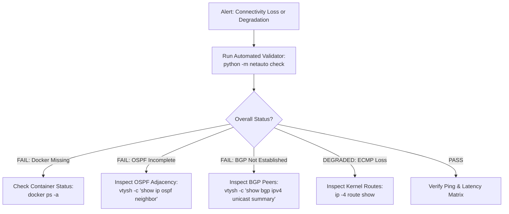

# Production Engineering Troubleshooting Guide

A practical troubleshooting manual and CLI cheatsheet for investigating issues in the Spine-Leaf fabric.

---

## 1. Fast Diagnostics Flowchart



---

## 2. Command Cheatsheet

### 2.1 FRRouting vtysh Commands

Connect to any router CLI directly:
```bash
docker exec -it clab-dc-fabric-lab-spine1 vtysh
# or leaf1:
docker exec -it clab-dc-fabric-lab-leaf1 vtysh
```

#### OSPF Diagnostics
```bash
# Check neighbor state and dead timers
show ip ospf neighbor
show ip ospf neighbor json

# Check interface IP, network type, and area
show ip ospf interface
show ip ospf interface eth1

# Check OSPF LSDB (Link State Database)
show ip ospf database
```

#### BGP Diagnostics
```bash
# Check BGP summary (peer IP, remote AS, state, prefixes)
show bgp ipv4 unicast summary
show bgp ipv4 unicast summary json

# Check BGP RIB for a specific prefix
show bgp ipv4 unicast 172.16.12.0/24
show bgp ipv4 unicast 172.16.12.0/24 json

# Check advertised/received routes per neighbor
show bgp neighbors 10.0.0.0 advertised-routes
show bgp neighbors 10.0.0.0 routes
```

#### Routing Table & Forwarding
```bash
# Show full FRR RIB
show ip route

# Filter by protocol
show ip route ospf
show ip route bgp

# Inspect specific prefix
show ip route 172.16.12.0/24 json
```

### 2.2 Linux Host Diagnostics

```bash
# Inspect IP addresses
docker exec clab-dc-fabric-lab-host1 ip addr show

# Inspect routing table and default gateway
docker exec clab-dc-fabric-lab-host1 ip route show

# Ping another server container
docker exec clab-dc-fabric-lab-host1 ping -c 3 172.16.12.10

# Traceroute / hop-by-hop verification
docker exec clab-dc-fabric-lab-host1 traceroute -n 172.16.12.10
```

---

## 3. Top 5 Production Issues & Solutions

| Symptom | Likely Cause | Investigation Command | Solution |
|---|---|---|---|
| OSPF stuck in `ExStart` | MTU Mismatch | `show ip ospf interface` | Ensure MTU matches on both ends or set `ip ospf mtu-ignore` |
| BGP in `Active` state | Wrong remote ASN or unreachable peer | `show bgp summary`, `ping <peer_ip>` | Fix ASN in `inventory/fabric.yml` and run `python -m netauto apply` |
| Route not advertised | Route-map or prefix-list filter | `show bgp neighbors <ip> advertised-routes` | Verify `PL-LOCAL-SERVER` and `RM-SPINE-OUT` definitions |
| ECMP only has 1 next hop | BGP session down or `maximum-paths` unset | `show bgp ipv4 unicast <prefix>` | Verify `maximum-paths 2` in FRR BGP address-family |
| Host cannot reach gateway | Missing default route or IP not up | `ip route show` on host | Re-run host startup script or check containerlab exec hooks |
